<!-- fit-css -->

<!-- _class: sec -->
<!-- _paginate: false -->

โปรเจกต์ 1 สัปดาห์ · นำเสนอ 18 ต.ค. 2569

# โปรเจกต์ Smart Farm: เปิดโจทย์

เลือก 1 ใน 25 เรื่อง → รับโค้ดเริ่มต้น (บอร์ด + เว็บ) → ต่อยอดเองอย่างน้อย 3 อย่าง

กลุ่มละ 2 คน · ฝั่งบอร์ด (Smart HMI) + ฝั่งเว็บ (Web UI)

AIoT Development for Smart Farm · TESAIoT Dev Kit

---

## โจทย์ในประโยคเดียว

เลือก **1 ใน 25 เรื่อง** → นำ **โค้ดเริ่มต้น** ไป **ต่อยอดเองอย่างน้อย 3 อย่าง** 
ให้เป็นอุปกรณ์ Smart HMI ของทีม

- **วัดค่า**ได้ · **ตัดสินใจ**เองได้
- **เตือน**ด้วยเสียงและไฟ
- **ดูและสั่งงานจากมือถือ** ผ่าน MQTT

**ไม่มี AI ในโปรเจกต์นี้** · ใช้ของคาบ 1–2 และ MQTT เป็นหลัก 
Edge AI (คาบ 3) เรียนเพื่อเข้าใจหลักการเท่านั้น

---

## กติกา: เรื่องละ 1 ทีม

- 22 กลุ่ม เลือกจาก **25 เรื่อง** · **เรื่องละ 1 ทีม**
- เลือกเรื่องจาก **ลิงก์ / QR Code ที่อาจารย์แจ้งในคาบ** · **ใครกดก่อนได้ก่อน** เห็นผลทันทีทุกเครื่อง
- ทุกเรื่องมี **โค้ดเริ่มต้นครบ** (บอร์ด + หน้าเว็บ) ใน `project/`

**ห้ามส่งโค้ดเริ่มต้นตามที่ได้ไป** · ต้องต่อยอดเองอย่างน้อย 3 อย่าง

- บอกให้ชัดว่า **ส่วนไหนมาจากโค้ดเริ่มต้น** และ **ส่วนไหนทีมทำเอง** (เขียนในหัวไฟล์ด้วย)

---

## 25 เรื่อง · 4 ชุดเริ่มต้น

| ชุดเริ่มต้น | เรื่อง (เลขไฟล์ `project/idea_N_*.py`) |
|---|---|
| **A** เฝ้าอากาศ + เตือน + รับทราบ | 1 ห้องเย็นผลไม้ · 2 รถส่งผลผลิต · 3 ไซโลข้าวเปลือก · 8 เล้าไก่ · 9 โรงเพาะเห็ด · 10 ห้องบ่มกล้วย · 11 โรงอบลำไย · 12 โกดังเมล็ดพันธุ์ · 13 โกดังปุ๋ย · 14 ตู้ยาและวัคซีนสัตว์ · 15 ไฮโดรโปนิกส์ |
| **B** สั่งเครื่องจากมือถือ + กฎปลอดภัย | 4 โรงเรือนรดน้ำ · 6 หอถังน้ำ · 16 พ่นหมอกกล้วยไม้ · 17 เติมอากาศบ่อปลา · 18 พัดลมเล้าไก่ · 19 ประตูน้ำแปลงนา · 20 ให้อาหารปลา |
| **C** การสั่นผิดปกติ + หยุดเครื่อง (กฎธรรมดา ไม่ใช้ AI) | 7 หมอฟังปั๊ม · 21 พัดลมโรงเรือน · 22 เครื่องสีข้าว · 23 ถาดไข่ขนส่ง · 24 ลังผลไม้บนกระบะ |
| **D** เรดาร์จับผู้บุกรุก (กฎธรรมดา ไม่ใช้ AI) | 5 คอกกลางคืน · 25 ประตูโกดังกันขโมย |

หน้าเว็บของแต่ละเรื่อง: project/web/idea_N.html · เกณฑ์ในโค้ดเริ่มต้นเป็นค่าสาธิต ทีมต้องตั้งใหม่ · ตัวอย่าง Edge AI 3 ตัวใน project/ai_future/ เป็นแนวทางอนาคต ไม่อยู่ในโจทย์

---

## ตัวอย่างชุด A–B: จอบอร์ด + หน้าเว็บ (เรื่อง 1–4)

<b class="pt">1 · กล่องขนส่งผลไม้ห้องเย็น</b>
<figure>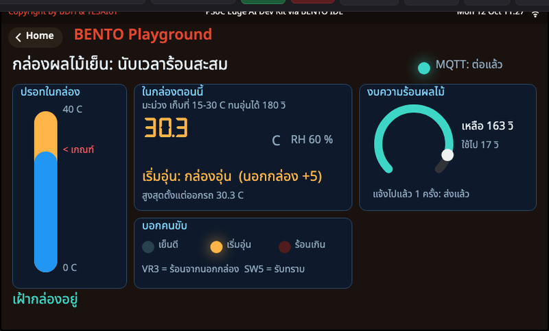<figcaption>จอบอร์ดใน BENTO Emulator</figcaption></figure><figure>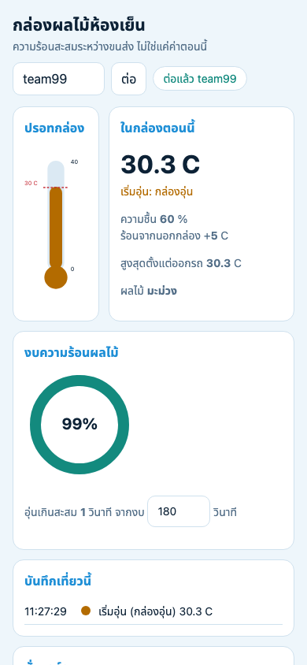<figcaption>หน้าเว็บ รับค่าจริงจากบอร์ดใน Emulator</figcaption></figure>

<b class="pt">2 · รถส่งผลผลิตถึงตลาด</b>
<figure>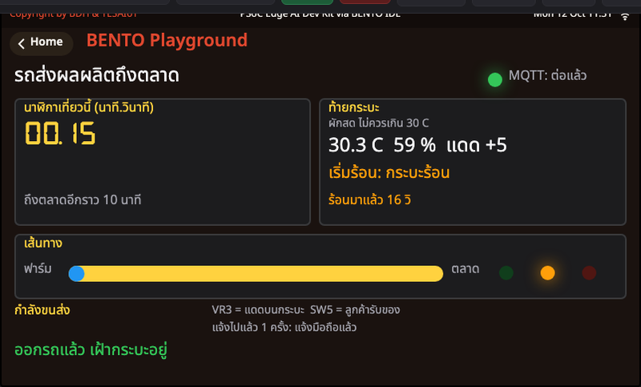<figcaption>จอบอร์ดใน BENTO Emulator</figcaption></figure><figure>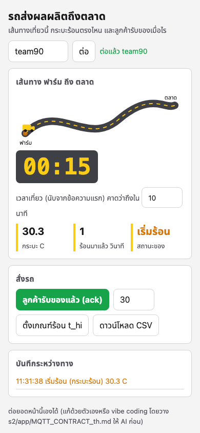<figcaption>หน้าเว็บ รับค่าจริงจากบอร์ดใน Emulator</figcaption></figure>

<b class="pt">3 · ไซโลข้าวเปลือก</b>
<figure>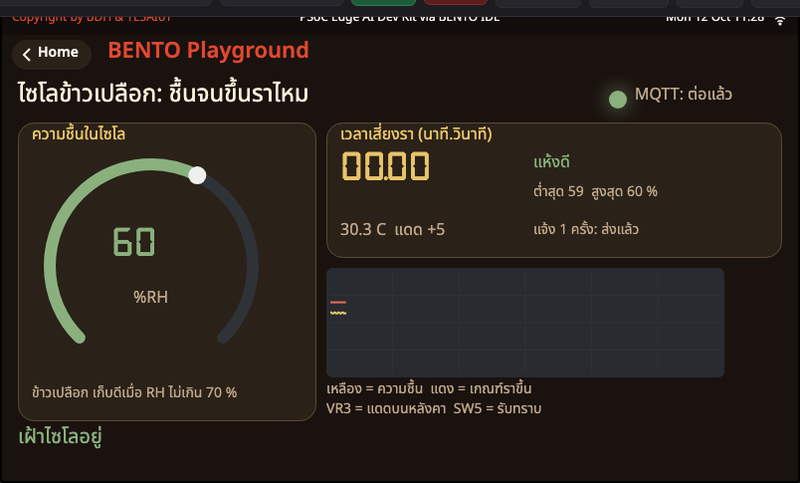<figcaption>จอบอร์ดใน BENTO Emulator</figcaption></figure><figure>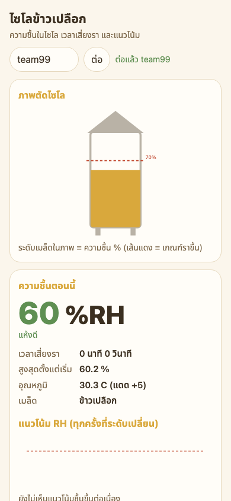<figcaption>หน้าเว็บ รับค่าจริงจากบอร์ดใน Emulator</figcaption></figure>

<b class="pt">4 · โรงเรือนอัจฉริยะ</b>
<figure>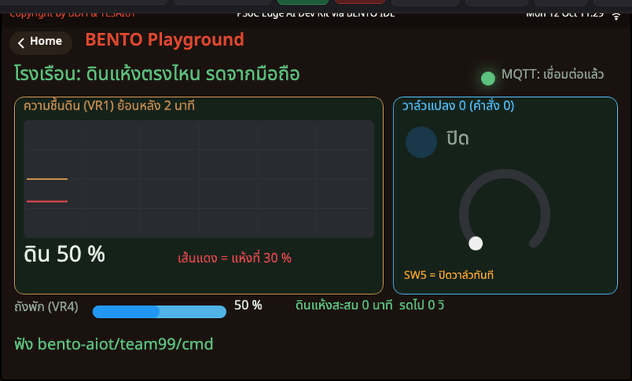<figcaption>จอบอร์ดใน BENTO Emulator</figcaption></figure><figure>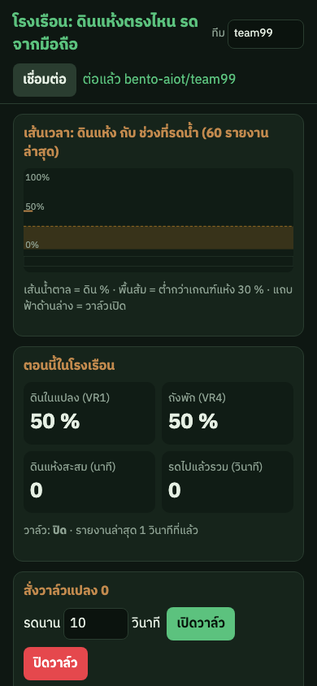<figcaption>หน้าเว็บ รับค่าจริงจากบอร์ดใน Emulator</figcaption></figure>

---

## ตัวอย่างชุด B–D: จอบอร์ด + หน้าเว็บ (เรื่อง 5–8)

<b class="pt">5 · คอกปศุสัตว์กลางคืน</b>
<figure>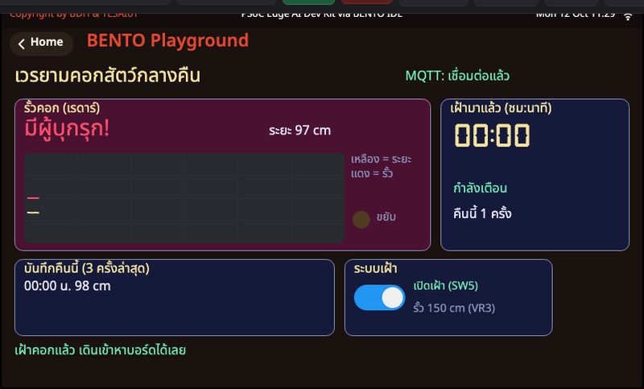<figcaption>จอบอร์ดใน BENTO Emulator</figcaption></figure><figure>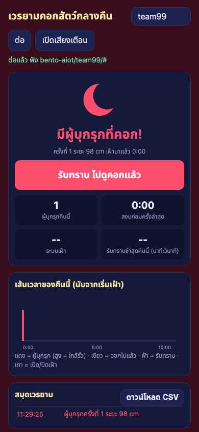<figcaption>หน้าเว็บ รับค่าจริงจากบอร์ดใน Emulator</figcaption></figure>

<b class="pt">6 · หอถังน้ำของฟาร์ม</b>
<figure>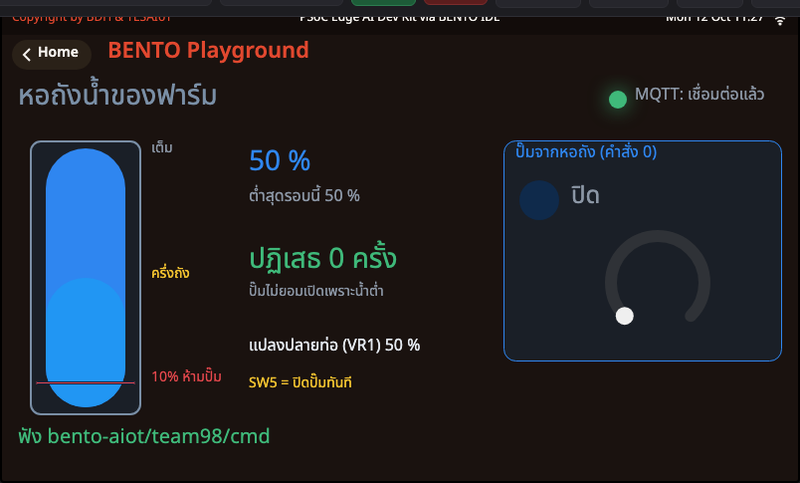<figcaption>จอบอร์ดใน BENTO Emulator</figcaption></figure><figure>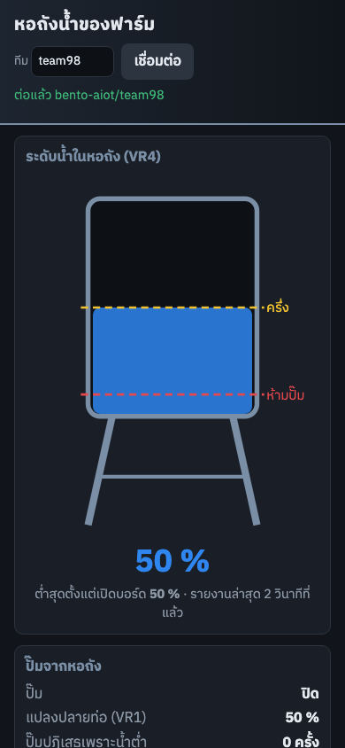<figcaption>หน้าเว็บ รับค่าจริงจากบอร์ดใน Emulator</figcaption></figure>

<b class="pt">7 · หมอฟังปั๊ม/พัดลม</b>
<figure>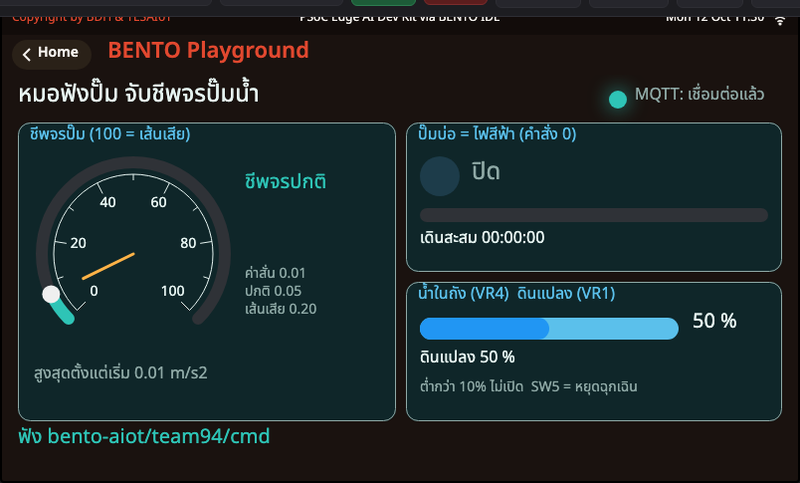<figcaption>จอบอร์ดใน BENTO Emulator</figcaption></figure><figure>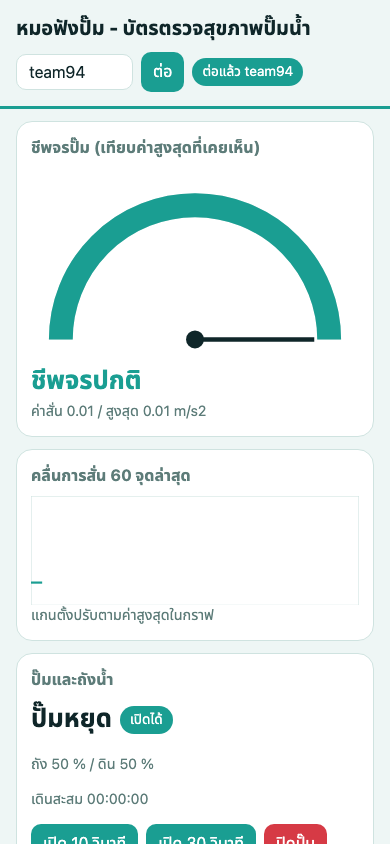<figcaption>หน้าเว็บ รับค่าจริงจากบอร์ดใน Emulator</figcaption></figure>

<b class="pt">8 · เล้าไก่กันความเครียดฝูง</b>
<figure>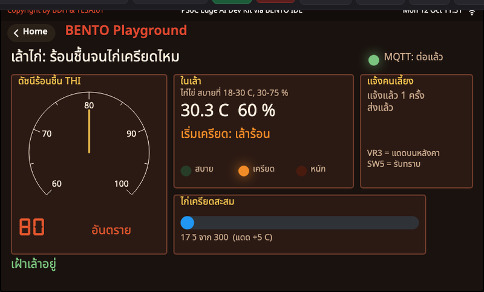<figcaption>จอบอร์ดใน BENTO Emulator</figcaption></figure><figure>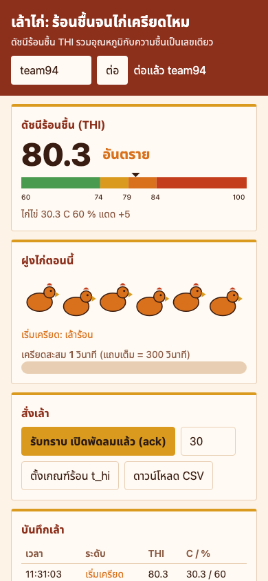<figcaption>หน้าเว็บ รับค่าจริงจากบอร์ดใน Emulator</figcaption></figure>

---

## ทุกเรื่องมีจอและหน้าเว็บของตัวเอง (เรื่อง 9–12)

<b class="pt">9 · โรงเพาะเห็ด (ชุด A)</b>
<figure>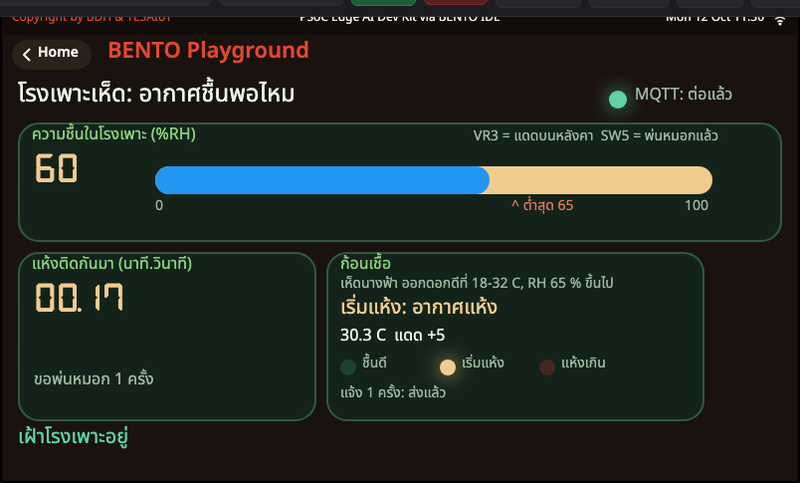<figcaption>จอบอร์ดใน BENTO Emulator</figcaption></figure><figure>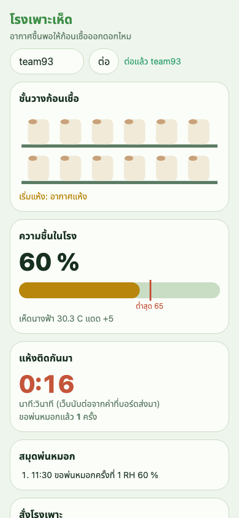<figcaption>หน้าเว็บ รับค่าจริงจากบอร์ดใน Emulator</figcaption></figure>

<b class="pt">10 · ห้องบ่มกล้วย (ชุด A)</b>
<figure>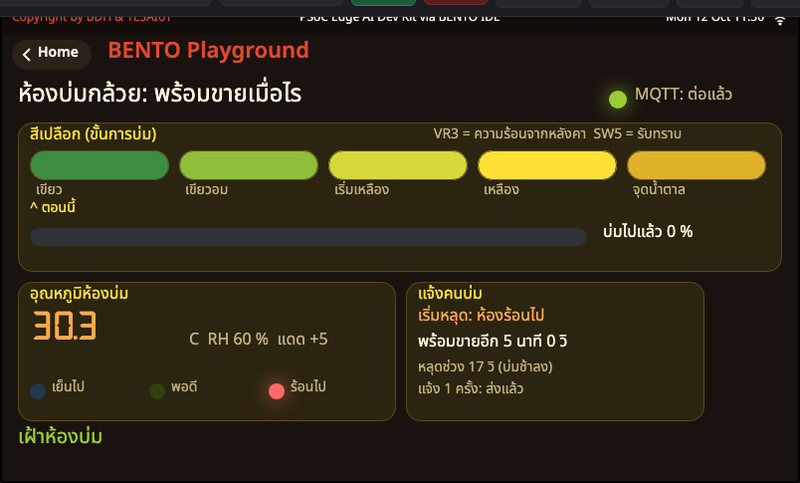<figcaption>จอบอร์ดใน BENTO Emulator</figcaption></figure><figure>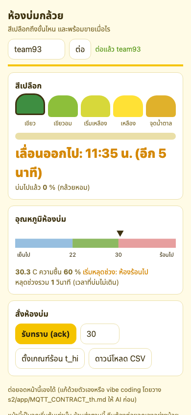<figcaption>หน้าเว็บ รับค่าจริงจากบอร์ดใน Emulator</figcaption></figure>

<b class="pt">11 · โรงอบลำไย (ชุด A)</b>
<figure>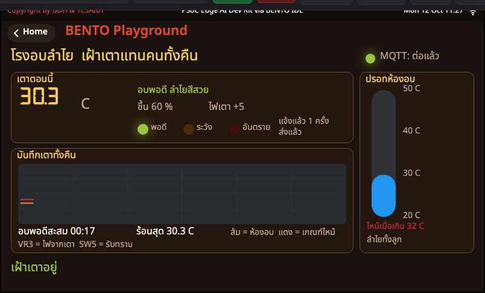<figcaption>จอบอร์ดใน BENTO Emulator</figcaption></figure><figure>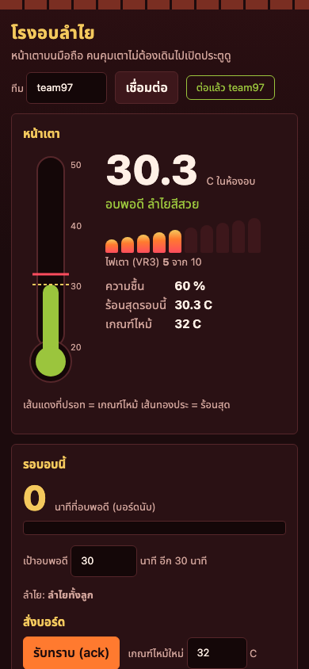<figcaption>หน้าเว็บ รับค่าจริงจากบอร์ดใน Emulator</figcaption></figure>

<b class="pt">12 · โกดังเก็บเมล็ดพันธุ์ (ชุด A)</b>
<figure>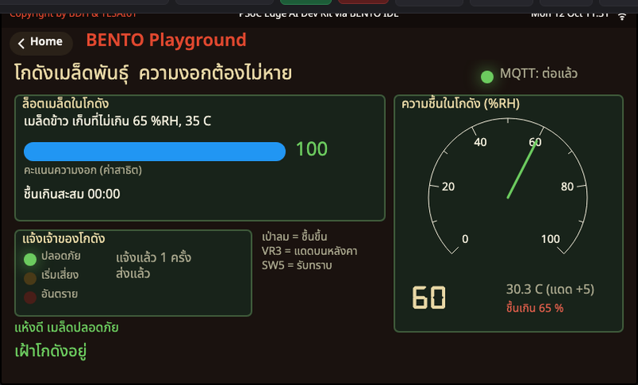<figcaption>จอบอร์ดใน BENTO Emulator</figcaption></figure><figure>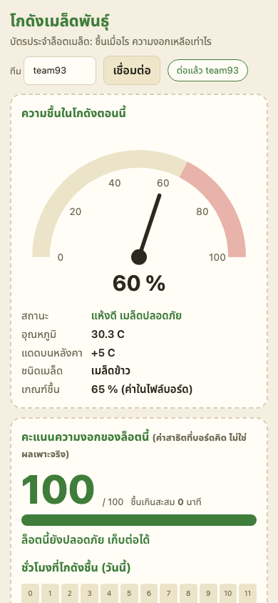<figcaption>หน้าเว็บ รับค่าจริงจากบอร์ดใน Emulator</figcaption></figure>

---

## ทุกเรื่องมีจอและหน้าเว็บของตัวเอง (เรื่อง 13–16)

<b class="pt">13 · โกดังปุ๋ย (ชุด A)</b>
<figure>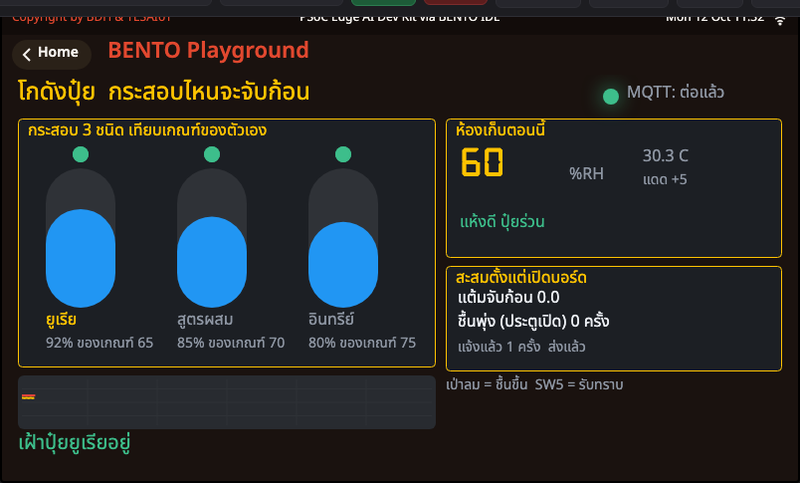<figcaption>จอบอร์ดใน BENTO Emulator</figcaption></figure><figure>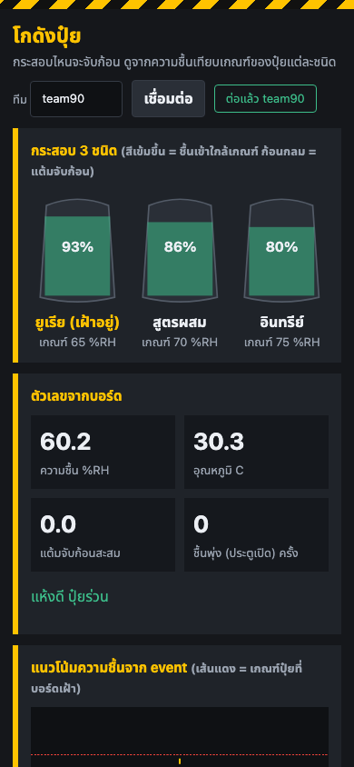<figcaption>หน้าเว็บ รับค่าจริงจากบอร์ดใน Emulator</figcaption></figure>

<b class="pt">14 · ตู้เก็บยาและวัคซีนสัตว์ (ชุด A)</b>
<figure>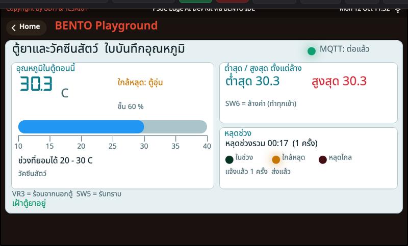<figcaption>จอบอร์ดใน BENTO Emulator</figcaption></figure><figure>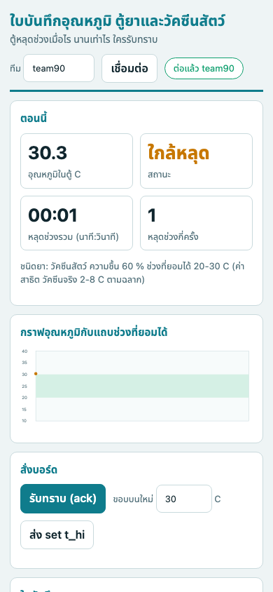<figcaption>หน้าเว็บ รับค่าจริงจากบอร์ดใน Emulator</figcaption></figure>

<b class="pt">15 · โรงเรือนไฮโดรโปนิกส์ (ชุด A)</b>
<figure>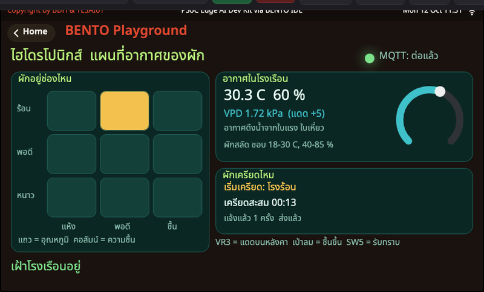<figcaption>จอบอร์ดใน BENTO Emulator</figcaption></figure><figure>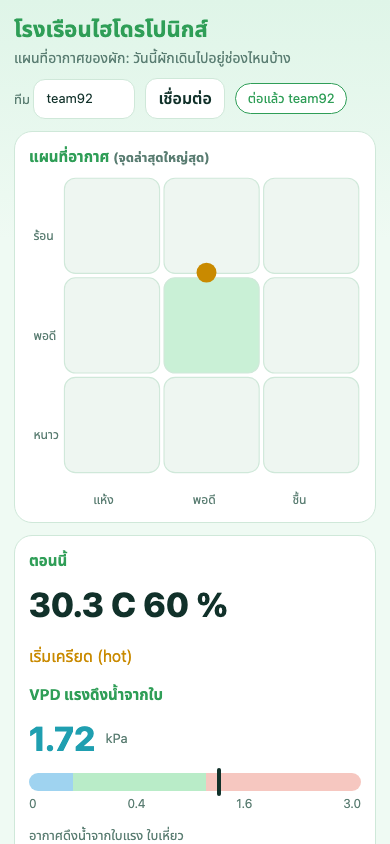<figcaption>หน้าเว็บ รับค่าจริงจากบอร์ดใน Emulator</figcaption></figure>

<b class="pt">16 · พ่นหมอกโรงกล้วยไม้ (ชุด B)</b>
<figure>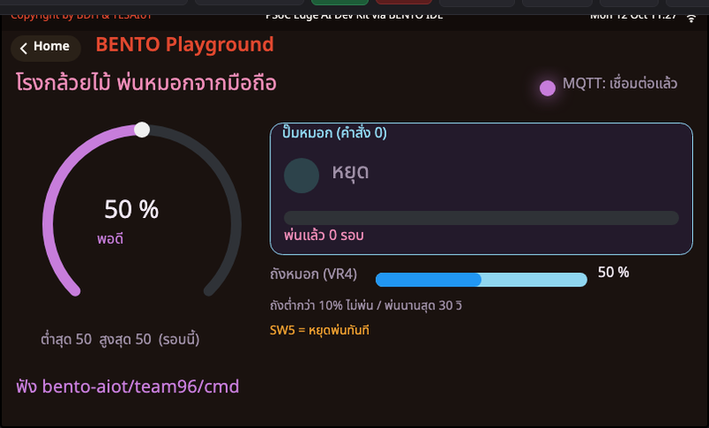<figcaption>จอบอร์ดใน BENTO Emulator</figcaption></figure><figure>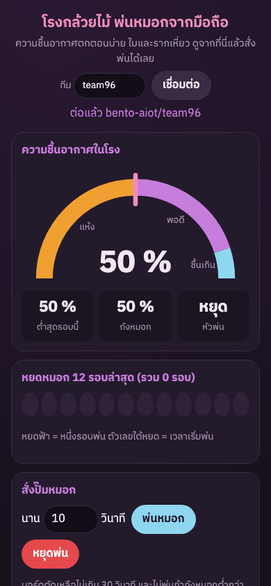<figcaption>หน้าเว็บ รับค่าจริงจากบอร์ดใน Emulator</figcaption></figure>

---

## ทุกเรื่องมีจอและหน้าเว็บของตัวเอง (เรื่อง 17–20)

<b class="pt">17 · เติมอากาศบ่อปลา (ชุด B)</b>
<figure>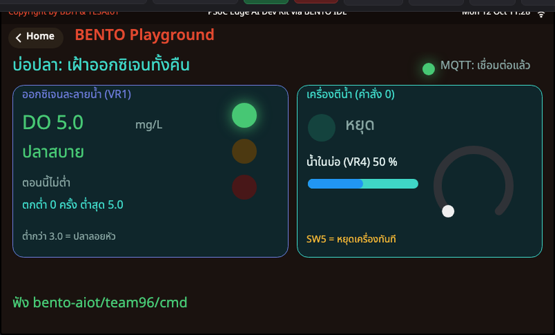<figcaption>จอบอร์ดใน BENTO Emulator</figcaption></figure><figure>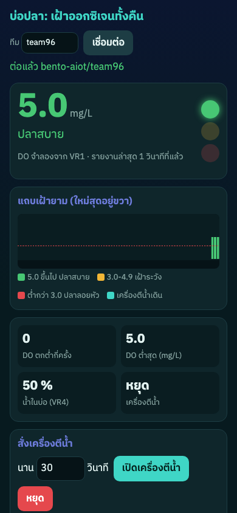<figcaption>หน้าเว็บ รับค่าจริงจากบอร์ดใน Emulator</figcaption></figure>

<b class="pt">18 · พัดลมเล้าไก่ (ชุด B)</b>
<figure>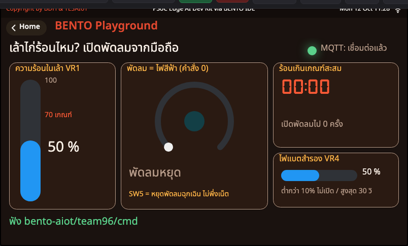<figcaption>จอบอร์ดใน BENTO Emulator</figcaption></figure><figure>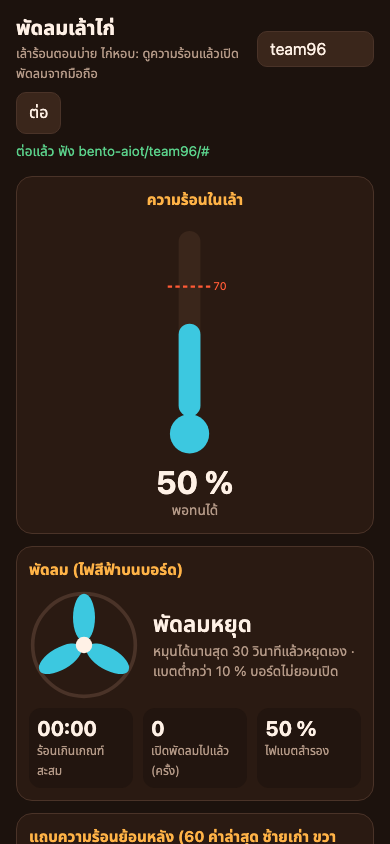<figcaption>หน้าเว็บ รับค่าจริงจากบอร์ดใน Emulator</figcaption></figure>

<b class="pt">19 · ประตูน้ำแปลงนา (ชุด B)</b>
<figure>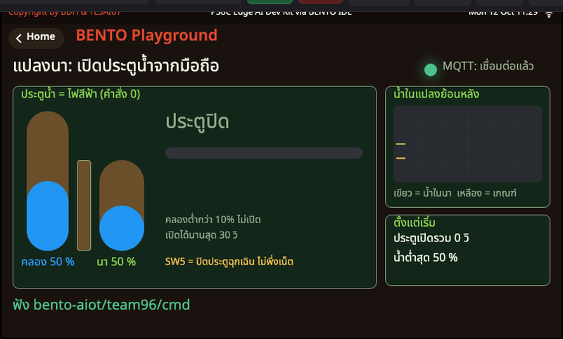<figcaption>จอบอร์ดใน BENTO Emulator</figcaption></figure><figure>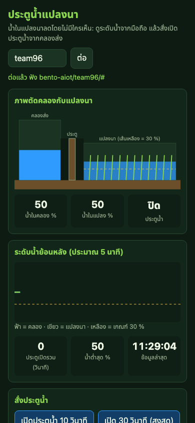<figcaption>หน้าเว็บ รับค่าจริงจากบอร์ดใน Emulator</figcaption></figure>

<b class="pt">20 · เครื่องให้อาหารปลา (ชุด B)</b>
<figure>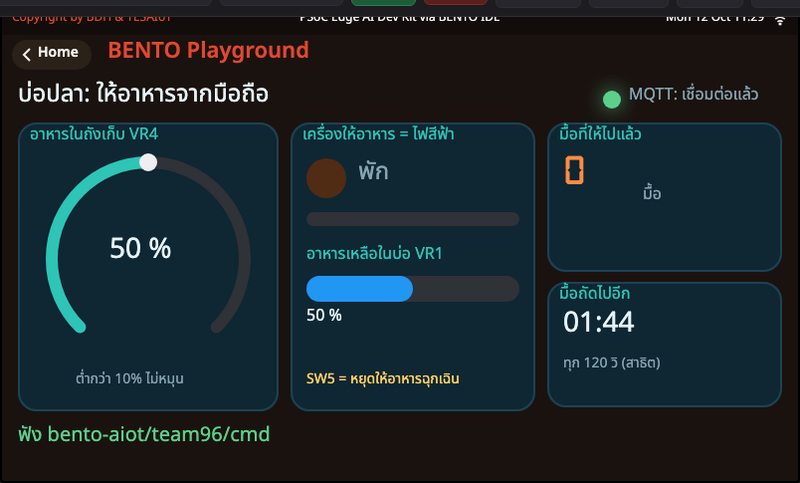<figcaption>จอบอร์ดใน BENTO Emulator</figcaption></figure><figure>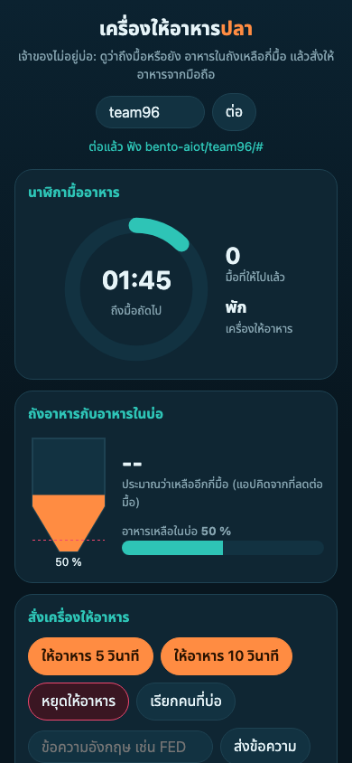<figcaption>หน้าเว็บ รับค่าจริงจากบอร์ดใน Emulator</figcaption></figure>

---

## ทุกเรื่องมีจอและหน้าเว็บของตัวเอง (เรื่อง 21–24)

<b class="pt">21 · พัดลมโรงเรือนสั่นผิดปกติ (ชุด C)</b>
<figure>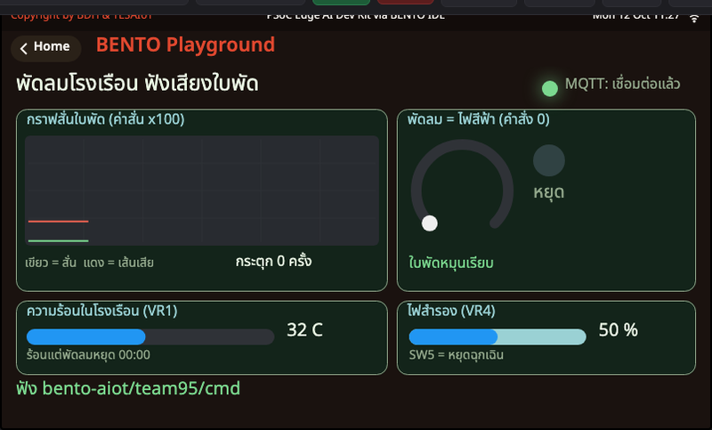<figcaption>จอบอร์ดใน BENTO Emulator</figcaption></figure><figure>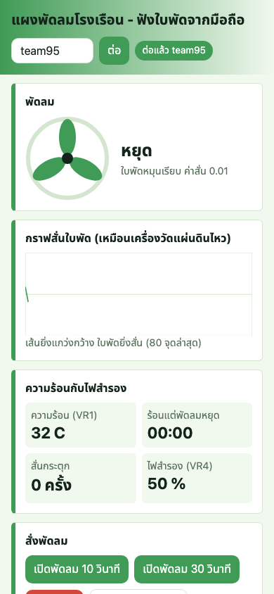<figcaption>หน้าเว็บ รับค่าจริงจากบอร์ดใน Emulator</figcaption></figure>

<b class="pt">22 · เครื่องสีข้าวชุมชน (ชุด C)</b>
<figure>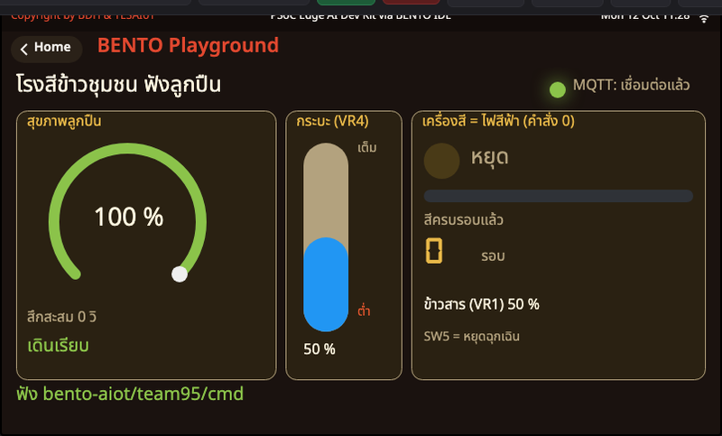<figcaption>จอบอร์ดใน BENTO Emulator</figcaption></figure><figure>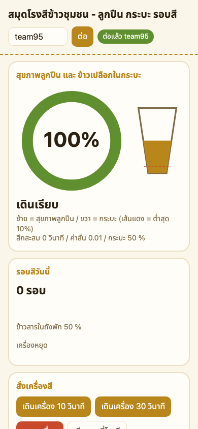<figcaption>หน้าเว็บ รับค่าจริงจากบอร์ดใน Emulator</figcaption></figure>

<b class="pt">23 · ถาดไข่ระหว่างขนส่ง (ชุด C)</b>
<figure>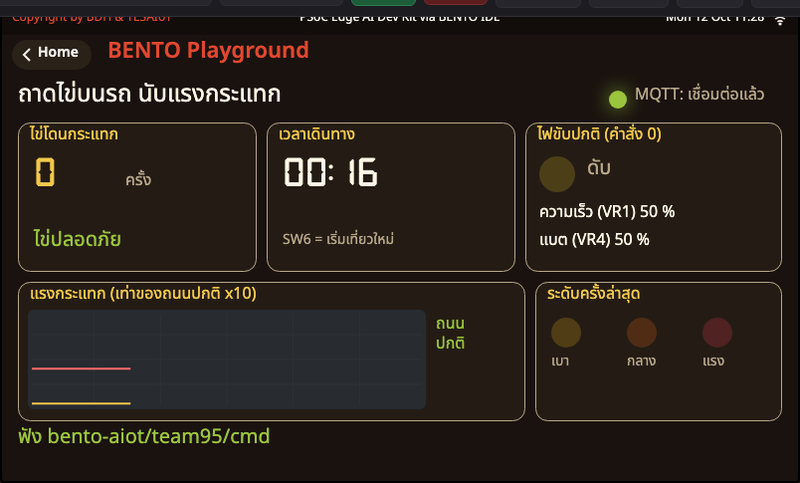<figcaption>จอบอร์ดใน BENTO Emulator</figcaption></figure><figure>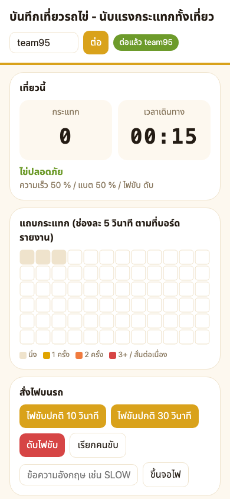<figcaption>หน้าเว็บ รับค่าจริงจากบอร์ดใน Emulator</figcaption></figure>

<b class="pt">24 · ลังผลไม้บนรถกระบะ (ชุด C)</b>
<figure>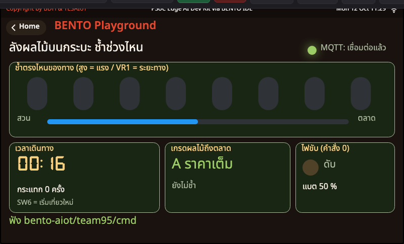<figcaption>จอบอร์ดใน BENTO Emulator</figcaption></figure><figure>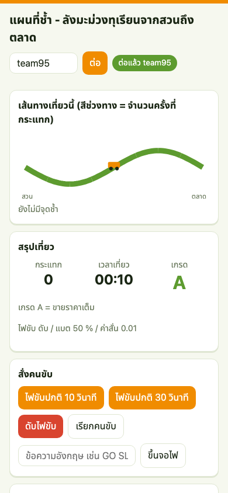<figcaption>หน้าเว็บ รับค่าจริงจากบอร์ดใน Emulator</figcaption></figure>

---

## ทุกเรื่องมีจอและหน้าเว็บของตัวเอง (เรื่อง 25)

<b class="pt">25 · ประตูโกดังกันขโมย (ชุด D)</b>
<figure>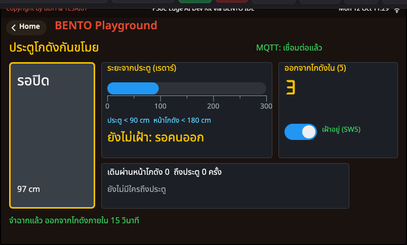<figcaption>จอบอร์ดใน BENTO Emulator</figcaption></figure><figure>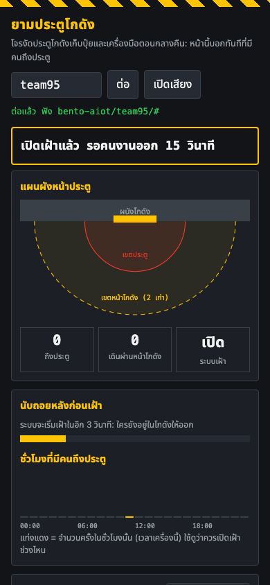<figcaption>หน้าเว็บ รับค่าจริงจากบอร์ดใน Emulator</figcaption></figure>

หน้าเว็บของทุกเรื่องรวมไว้ที่ <a href="https://advance-innovation-centre-aic.github.io/aiot-development-for-smart-farm/project/web/index.html" target="_blank" rel="noopener">project/web/index.html</a> · โค้ดเริ่มต้นเท่านั้น ต้องต่อยอดเอง 3 อย่าง

---

## ต่อยอดอย่างน้อย 3 อย่าง = หัวใจของคะแนน

| ข้อ | ทำอะไร | ตัวอย่าง |
|---|---|---|
| **1 · เกณฑ์ของเราเอง** (บังคับ) | วัดค่าจริง แล้วตั้งเกณฑ์ใหม่ พร้อมเหตุผล | วัดความชื้นห้อง 3 ครั้ง → เกณฑ์ไซโล 70 % |
| **2 · จอเป็นของผู้ใช้เรา** (บังคับ) | ชื่อ ป้าย ข้อความเตือน คำบน RGB matrix | จอคนขับรถส่งของ อ่านได้ใน 1 วินาที |
| **3 · ความสามารถเพิ่ม 1 อย่าง** | ฝั่งบอร์ด หรือฝั่งเว็บ | บอร์ด: นับครั้งที่เตือน · เว็บ: ปุ่มคำสั่งใหม่ · "บอร์ดเงียบเกิน 15 วินาที" · กราฟ · สรุป CSV |

ใช้ชุดเริ่มต้นโดยไม่ต่อยอดเลย → หมวดต่อยอด (30 คะแนน) = 0

---

## แบ่งหน้าที่ 2 คน

| ช่วงงาน | คนที่ 1 · ฝั่งบอร์ด | คนที่ 2 · ฝั่งเว็บ |
|---|---|---|
| คาบเสนอหัวข้อ | รันไฟล์ของเรื่องบนบอร์ดจริง | เปิด `web/idea_N.html?team=teamXX` เห็นค่าของกลุ่ม |
| ระหว่างสัปดาห์ | ต่อยอดข้อ 1–2 (+ ข้อ 3 ถ้าเลือกฝั่งบอร์ด) | ต่อยอดหน้าเว็บ (ข้อ 3 ถ้าเลือกฝั่งเว็บ) |
| วันนำเสนอ | สาธิตบอร์ด · ตอบเรื่องโค้ดบอร์ด | สาธิตเว็บ · ตอบเรื่องโค้ดเว็บ |

ฝั่งบอร์ด: **ไม่ใช้ vibe coding เขียนใหม่ทั้งไฟล์** — AI ทั่วไปไม่รู้จัก API ของบอร์ด 
ฝั่งเว็บ: vibe coding ได้ · วาง `MQTT_CONTRACT_th.md` ให้ก่อน · ทดสอบกับ `fake_board.html`

---

## เริ่มให้ได้ใน 10 นาที

<ol class="steps">
<li>คัดลอกไฟล์ของเรื่องเป็น <code>g&lt;เลขทีม&gt;_&lt;ชื่อโปรเจกต์&gt;.py</code></li>
<li>แก้ <code>WIFI_SSID</code> · <code>WIFI_PASS</code> · <code>TEAM</code></li>
<li>กด <b>Program to Device</b> → รันได้ก่อน แล้วค่อยแก้</li>
<li>มือถือเปิด <code>web/idea_N.html?team=teamXX</code></li>
</ol>

<figure><figcaption>ไม่ใส่ ?idea= → หน้าเลือกไอเดีย</figcaption></figure>

แก้ **ทีละ 1–2 จุด** แล้วรันดูทุกครั้ง 
เซฟสำเนาไฟล์ที่รันได้ก่อนแก้ทุกครั้ง

---

## ถ้าทำไม่ได้ จะไปต่ออย่างไร

| ถ้า… | ให้ทำแบบนี้ | ผลต่อคะแนน |
|---|---|---|
| แก้แล้วบอร์ด error | กลับไปไฟล์ที่รันได้ล่าสุด · แก้ทีละจุด | ไม่เสีย ถ้าวันนำเสนอรันได้ |
| ต่อยอดไม่ครบ 3 อย่าง | นำเสนอเท่าที่ทำได้ + แผนทำต่อ | หักเฉพาะหมวดต่อยอด |
| เว็บที่แก้เองพัง | เปิด `web/idea_N.html` ตัวเดิมของคอร์ส | หักเฉพาะส่วนเว็บที่ต่อยอด |
| เน็ต/broker ล่มวันนำเสนอ | สาธิตบอร์ดสด + คลิปสำรองฝั่งมือถือ | ไม่เสียส่วนเว็บ ถ้ามีคลิป |
| ติดจนไปต่อไม่ได้ | ส่งภาพจอบอร์ด + error ในกลุ่มแชท | ไม่เสีย |

**จุดตรวจวันที่ 3:** ส่งภาพจอบอร์ด + ภาพหน้าเว็บที่เห็นค่าของกลุ่ม ในกลุ่มแชทของคอร์ส

---

## ปฏิทิน 1 สัปดาห์

| เมื่อไร | คนที่ 1 · ฝั่งบอร์ด | คนที่ 2 · ฝั่งเว็บ |
|---|---|---|
| คาบเสนอหัวข้อ | เลือกเรื่อง · ลงชื่อ · รันไฟล์ของเรื่อง | เปิดเว็บเห็นค่า · กรอกใบเสนอโจทย์ |
| วันที่ 1–2 | ข้อ 1: วัดค่า ตั้งเกณฑ์ | ปรับ `IDEAS` ในหน้าเว็บ |
| วันที่ 3–4 | ข้อ 2: จอของผู้ใช้เรา · ส่งภาพจุดตรวจ | ข้อ 3 (ถ้าฝั่งเว็บ) · ส่งภาพจุดตรวจ |
| วันที่ 5–6 | ทดสอบ 3 กรณี · อัดคลิปสำรอง | สไลด์ 3–5 หน้า · ซ้อม |
| **18 ต.ค. 2569** | **สาธิตบอร์ด** | **สาธิตเว็บ** |

นำเสนอ 5–6 นาที + ถาม-ตอบ 2 นาที · ถามทั้งสองคน

---

## เกณฑ์ให้คะแนน (100)

| หมวด | คะแนน | ดีมาก |
|---|---|---|
| ปัญหา ผู้ใช้ และคุณค่า | 15 | ผู้ใช้ชัด ไม่ซ้ำ · ลดความเสียหายอะไร |
| **สิ่งที่ทีมต่อยอดเอง (3 อย่าง)** | **30** | เกณฑ์จากค่าที่วัดเอง · จอตรงผู้ใช้ · ฟีเจอร์เพิ่มทำงานจริง |
| บอร์ดทำงานครบในการสาธิต | 20 | ครบทุกส่วน + พิสูจน์กรณี "ไม่ควรเตือน" |
| MQTT + หน้าเว็บ | 15 | มือถือเห็นค่าจริง · สั่งกลับแล้วบอร์ดตอบ |
| สาธิต + ทดสอบ + ตอบคำถาม | 20 | ตรงเวลา · ทุกคนพูด · ผลทดสอบ 3 กรณี |

broker.hivemq.com ไม่เข้ารหัส — <b>ห้ามส่งรหัสผ่านหรือข้อมูลส่วนตัว</b> · บอกให้ชัดว่าค่าไหนวัดจริง ค่าไหนจำลอง

